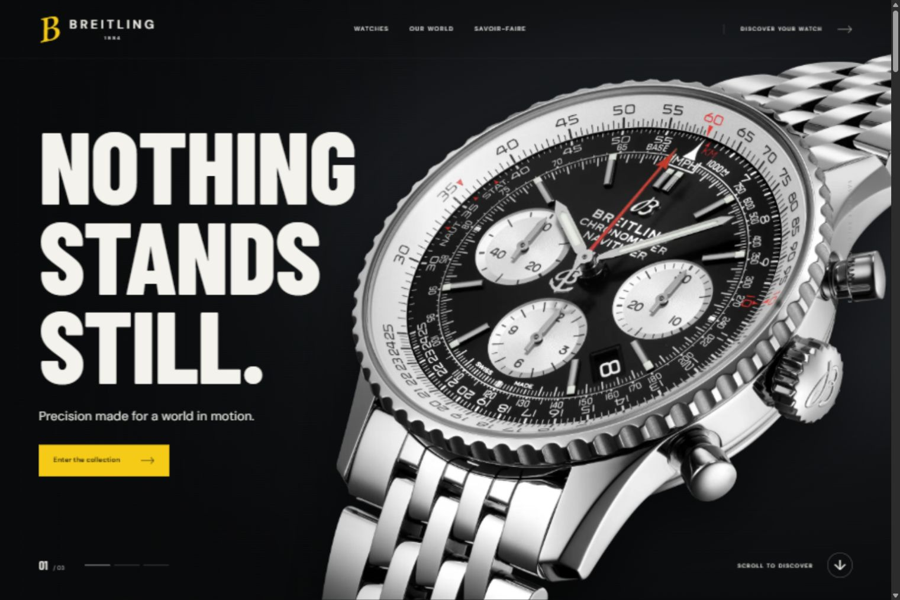

# Breitling Atelier

A watch website built with Three.js, GSAP and Vite. Explore six collections, compare watches and scroll through the history and craft behind them.



## Run it locally

Install [Node.js](https://nodejs.org/) 22.12 or newer. Then open a terminal:

```sh
git clone https://github.com/itszyless/threejs-watch-showcase.git
cd threejs-watch-showcase
npm install
npm run dev
```

Open **http://localhost:5174**.

On Windows, you can also double-click `start.cmd` after installing Node.js.

## What you can explore

- Ten pages, including six watch detail pages
- Scroll animations, image galleries and smooth navigation
- Collection filters, search and a two-watch comparison
- An interactive Three.js watch with an exploded view
- A real Superocean model in the Sketchfab viewer
- Responsive layouts and support for reduced motion

## Pages

| Page | Path |
| --- | --- |
| Home | `/` |
| Collections | `/collections` |
| Our World | `/our-world` |
| Craftsmanship | `/craftsmanship` |
| Navitimer | `/watches/navitimer` |
| Superocean | `/watches/superocean` |
| Chronomat | `/watches/chronomat` |
| Top Time | `/watches/top-time` |
| Premier | `/watches/premier` |
| Avenger | `/watches/avenger` |

## Build

```sh
npm run build
npm run preview
```

The build is saved in `dist`. If you host it, send page requests such as `/collections` to `index.html`.

## Project files

- `src/pages.js`: page layouts
- `src/data.js`: collection and editorial content
- `src/watch.js`: Three.js watch scene
- `src/motion.js`: scroll animations
- `src/style.css`: shared styles
- `public/assets`: local images and fonts

The site uses plain JavaScript. No account, API key or database is needed. The embedded Sketchfab model needs internet access.

## Credits

This is an independent design study. It is not affiliated with Breitling. Photos and trademarks belong to their owners. There is no checkout or booking service.

Watch photos and editorial images come from [Breitling](https://www.breitling.com/). Product references and history are linked in the site.

The [Superocean Automatic 44 model](https://sketchfab.com/3d-models/breitling-superocean-automatic-44-watch-b910729e03c1403a89a8767dd62616b0) is by **Ethan Mulwee**, shared under [CC BY 4.0](https://creativecommons.org/licenses/by/4.0/). It is shown through Sketchfab's public viewer.

The separate Three.js watch is a custom illustration. It is not official CAD and does not show exact manufacturing dimensions.
